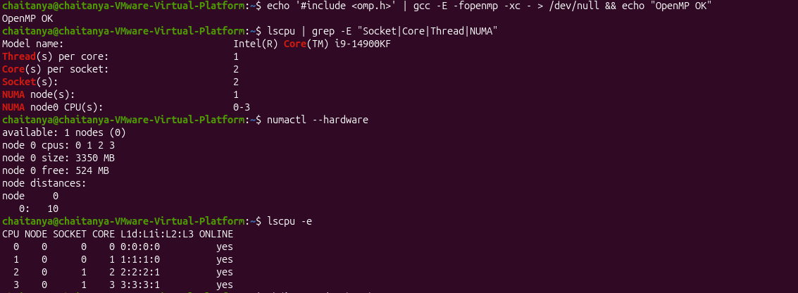
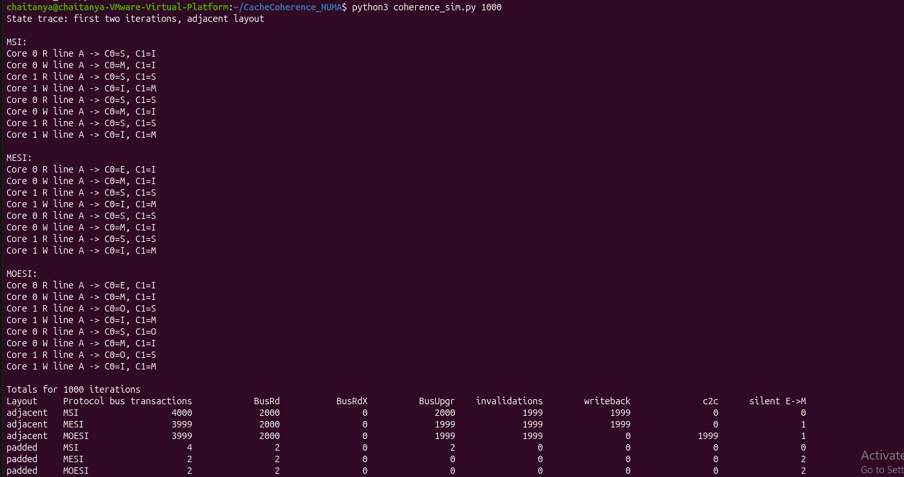
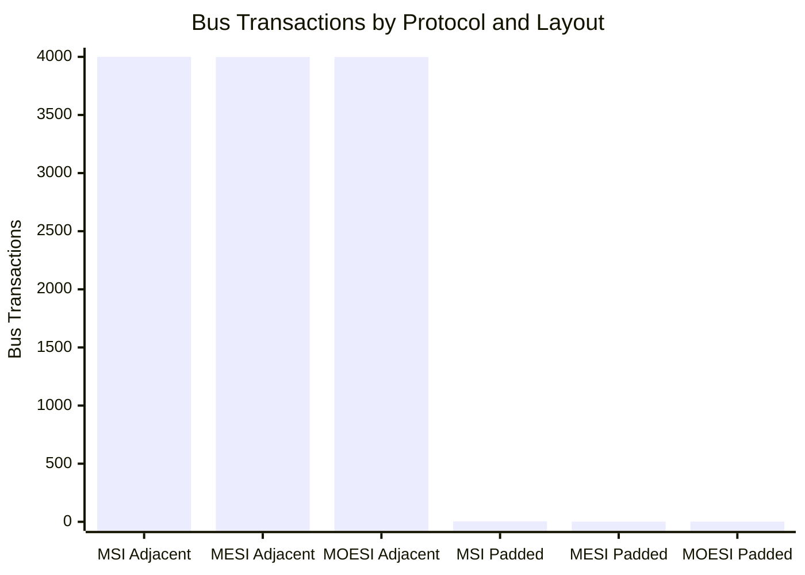
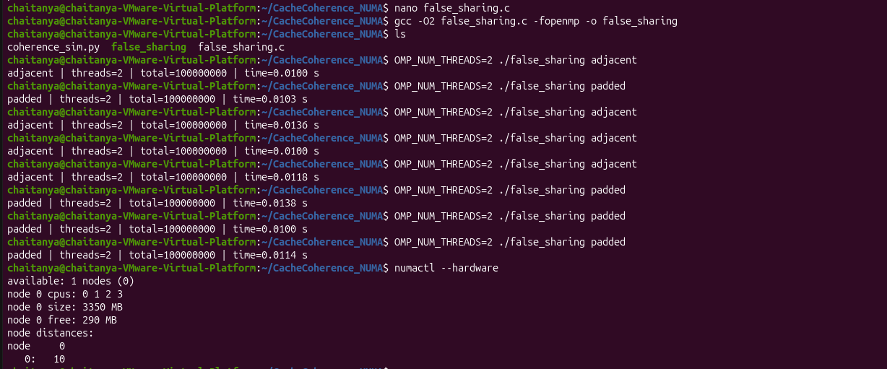
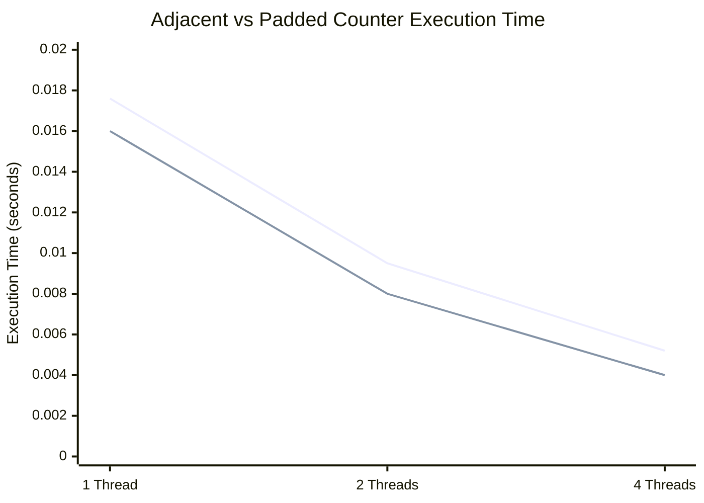
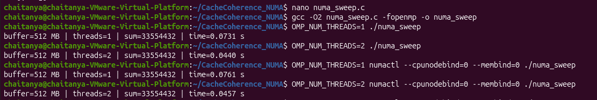
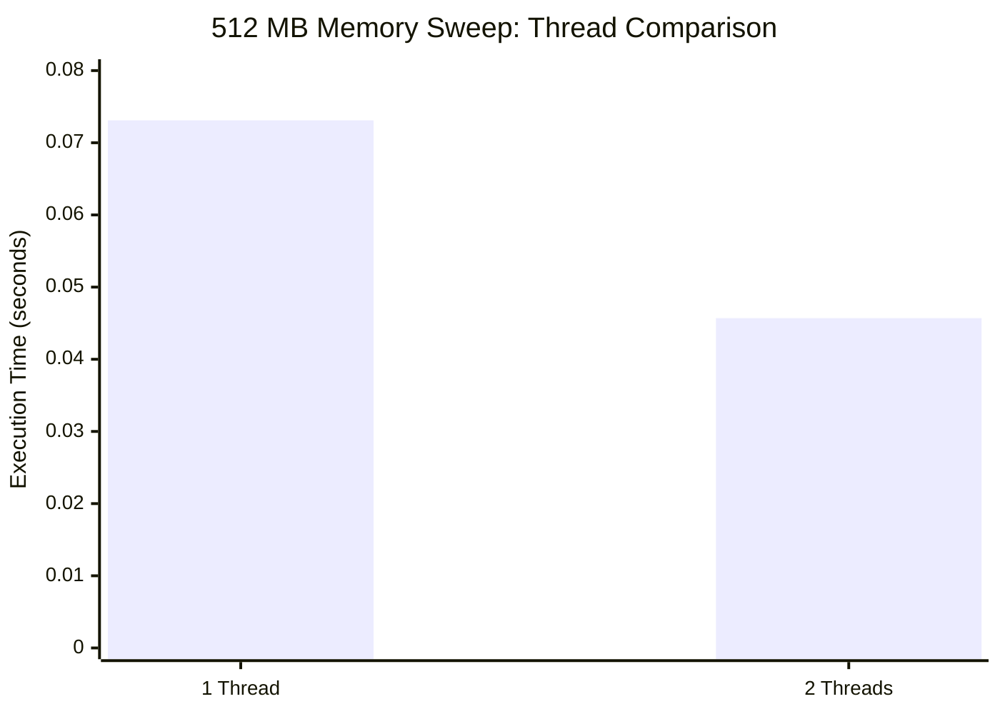
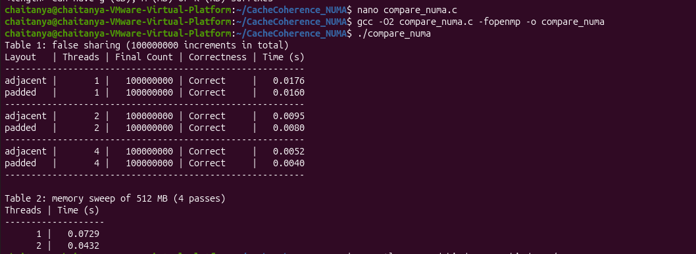
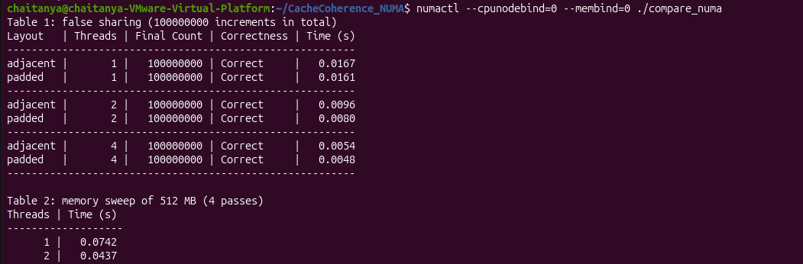

# Cache Coherence and NUMA Performance Lab

## Overview

This project investigates cache coherence protocols, false sharing, multithreaded execution, and NUMA memory placement using Python, C, and OpenMP. The experiments were conducted in Ubuntu Linux running inside VMware.

The project compares MSI, MESI, and MOESI cache coherence protocols, measures the performance of adjacent and padded counters, and evaluates memory-sweep execution time with different thread counts.

## Objectives

- Simulate MSI, MESI, and MOESI cache coherence protocols.
- Analyze cache-state transitions and modeled bus transactions.
- Investigate false sharing using adjacent and padded counters.
- Compare execution times using different OpenMP thread counts.
- Examine memory placement using `numactl`.
- Visualize experimental results through comparison graphs.
- Document the experiments using terminal screenshots.

## Technologies Used

- Ubuntu Linux
- VMware
- C programming language
- Python 3
- GCC
- OpenMP
- `numactl`
- `hwloc`
- Git and GitHub
- Mermaid charts

## Repository Structure

```text
cache-coherence-numa-lab/
├── README.md
├── coherence_sim.py
├── false_sharing.c
├── numa_sweep.c
├── compare_numa.c
└── screenshots/
    ├── 01-ubuntu-environment-and-numa-hardware-setup.png.png
    ├── 02-msi-mesi-moesi-cache-coherence-simulation.png.png
    ├── 03-false-sharing-adjacent-vs-padded-counters.png.png
    ├── 04-numa-memory-sweep-single-vs-multithread.png.png
    ├── 05-combined-false-sharing-and-memory-sweep-results.png.png
    ├── 06-numa-node-bound-benchmark-results.png.png
    └── README.md
```

## Hardware and Environment Setup

The experiments were conducted inside an Ubuntu virtual machine running on VMware.

- Processor reported by the environment: Intel Core i9-14900KF
- Logical CPUs available to the virtual machine: 4
- Available NUMA nodes: 1
- Programming languages: C and Python
- Parallel programming model: OpenMP

### Screenshot 1: Ubuntu Environment and NUMA Hardware Setup

This screenshot verifies OpenMP support and displays CPU topology, available logical CPUs, and NUMA information.



## Experiment 1: MSI, MESI, and MOESI Cache Coherence Simulation

The Python simulator models three cache coherence protocols:

- **MSI:** Modified, Shared, and Invalid states.
- **MESI:** Modified, Exclusive, Shared, and Invalid states.
- **MOESI:** Modified, Owned, Exclusive, Shared, and Invalid states.

The simulator records modeled bus transactions, invalidations, writebacks, cache-to-cache transfers, and silent Exclusive-to-Modified transitions.

### Execution Command

```bash
python3 coherence_sim.py 1000
```

### Screenshot 2: Cache Coherence Simulation Results



### Comparison Graph: Bus Transactions

The following chart uses the bus transaction totals displayed by the simulator for 1,000 iterations.



### Interpretation

- The adjacent layout produces substantially more modeled bus transactions than the padded layout.
- MESI and MOESI have one fewer modeled bus transaction than MSI in the adjacent case.
- In the padded case, the two protocols show fewer modeled transactions than MSI under the simulator's transition rules.

**Note:** These figures are simulation results, not hardware performance-counter measurements.

## Experiment 2: False Sharing — Adjacent vs. Padded Counters

This experiment uses C and OpenMP to compare adjacent counters with padded counters.

False sharing occurs when separate variables modified by different threads occupy the same cache line. Cache coherence can then generate unnecessary communication even though the threads are modifying different variables.

Padding separates the counters in memory to reduce the likelihood of false sharing.

### Compilation

```bash
gcc -O2 false_sharing.c -fopenmp -o false_sharing
```

### Execution

Adjacent counters:

```bash
OMP_NUM_THREADS=2 ./false_sharing adjacent
```

Padded counters:

```bash
OMP_NUM_THREADS=2 ./false_sharing padded
```

Both versions should produce the expected total of 100,000,000 increments.

### Screenshot 3: Adjacent vs. Padded Counter Benchmark



### Comparison Graph: Execution Time at Different Thread Counts

The following measurements come from the combined benchmark screenshot. Lower execution time indicates faster completion.



Series order: adjacent counters, then padded counters.

### Comparison Table

| Threads | Adjacent (s) | Padded (s) |
|---:|---:|---:|
| 1 | 0.0176 | 0.0160 |
| 2 | 0.0095 | 0.0080 |
| 4 | 0.0052 | 0.0040 |

### Interpretation

- The padded version was faster in the displayed combined-benchmark measurements.
- Execution time decreased as the thread count increased in these measurements.
- Padding can reduce false-sharing overhead, although the size of the benefit depends on the CPU, compiler, workload, and system load.

These values are individual measurements rather than averages across repeated runs.

## Experiment 3: NUMA Memory Sweep

This experiment measures the execution time of repeated memory-sweep operations over a 512 MB buffer.

The program accesses one byte every 64 bytes for four passes and compares execution with one and two OpenMP threads.

### Compilation

```bash
gcc -O2 numa_sweep.c -fopenmp -o numa_sweep
```

### Execution

One thread:

```bash
OMP_NUM_THREADS=1 ./numa_sweep
```

Two threads:

```bash
OMP_NUM_THREADS=2 ./numa_sweep
```

### Screenshot 4: NUMA Memory Sweep Results



### Comparison Graph: Memory Sweep Execution Time

The following measurements are taken from the unbound memory-sweep runs shown in the terminal screenshot.



### Comparison Table

| Threads | Execution time (s) |
|---:|---:|
| 1 | 0.0731 |
| 2 | 0.0457 |

### Interpretation

- The two-thread run completed faster than the one-thread run in the recorded measurements.
- Parallel execution can improve performance by distributing work across multiple threads.
- The observed speedup depends on CPU resources, memory bandwidth, virtualization, and system load.

## Experiment 4: Combined False-Sharing and Memory-Sweep Benchmark

The combined benchmark measures adjacent and padded counters using one, two, and four threads. It also measures memory-sweep execution time over a 512 MB buffer for four passes.

### Compilation and Execution

```bash
gcc -O2 compare_numa.c -fopenmp -o compare_numa
./compare_numa
```

### Screenshot 5: Combined Benchmark Results



### Correctness Results

The benchmark reported a final count of `100000000` for every counter configuration, with each result marked `Correct`.

This confirms that the counter totals matched the expected result in the recorded runs.

## Experiment 5: NUMA Node-Bound Benchmark

This experiment restricts CPU execution and memory allocation to NUMA node 0.

### Execution Command

```bash
numactl --cpunodebind=0 --membind=0 ./compare_numa
```

### Screenshot 6: NUMA Node-Bound Benchmark Results



### Comparison Table: Memory Sweep With Node Binding

| Threads | Unbound time (s) | Node-0-bound time (s) |
|---:|---:|---:|
| 1 | 0.0731 | 0.0742 |
| 2 | 0.0457 | 0.0437 |

### Comparison Graph

```mermaid
xychart-beta
    title "Memory Sweep: Unbound vs Node-0-Bound"
    x-axis ["1 Thread", "2 Threads"]
    y-axis "Execution Time (seconds)" 0 --> 0.08
    bar [0.0731, 0.0457]
    bar [0.0742, 0.0437]
```



Series order: unbound execution, then node-0-bound execution.

### Interpretation

- The measured times differ slightly between the unbound and node-bound runs.
- The virtual machine exposes only one NUMA node.
- Therefore, this experiment demonstrates CPU and memory binding but does not establish a genuine local-versus-remote NUMA performance comparison.

## Overall Observations

1. The cache coherence simulator demonstrates how different protocol states influence modeled bus transactions.
2. The padded-counter benchmark showed lower execution times than the adjacent-counter benchmark in the recorded combined-benchmark measurements.
3. Increasing the thread count reduced execution time in the recorded counter and memory-sweep benchmarks.
4. The NUMA node-bound measurements were similar to the unbound measurements, consistent with the limitation of having only one exposed NUMA node.
5. Actual timings can vary with CPU load, virtual machine configuration, compiler optimizations, and repeated execution.

## Conclusion

This project demonstrates cache coherence simulation, false-sharing analysis, multithreaded execution, and NUMA memory placement using Python, C, and OpenMP.

The results illustrate how cache protocol states, memory layout, and thread count can influence performance. The NUMA measurements also highlight the importance of understanding hardware topology when interpreting performance results.

## Author

**Chaitanya**

GitHub Repository: [Cache Coherence and NUMA Performance Lab](https://github.com/chaitanya-m5/cache-coherence-numa-lab)
